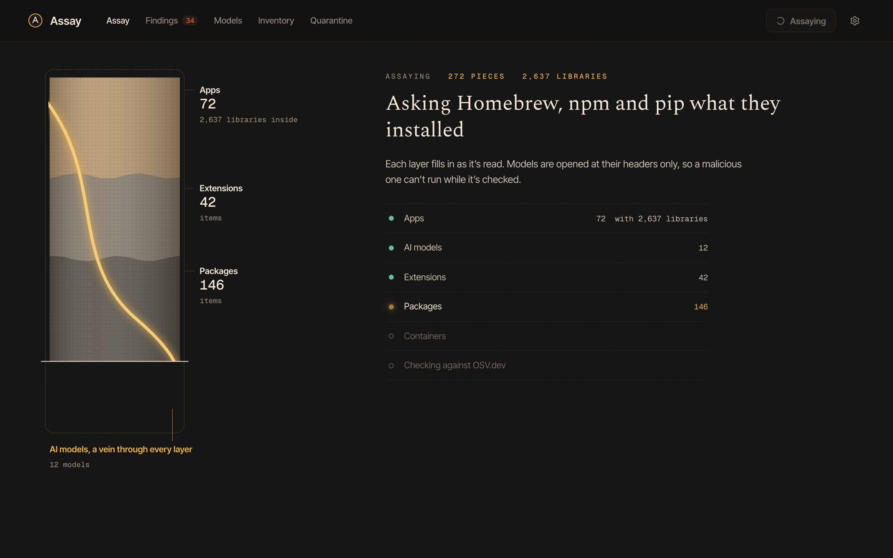

<p align="center">
  
</p>

<p align="center">
  <a href="#the-first-ten-seconds">Overview</a>&nbsp;&nbsp;&nbsp;
  <a href="#ai-models">AI models</a>&nbsp;&nbsp;&nbsp;
  <a href="#the-certificate">Certificates</a>&nbsp;&nbsp;&nbsp;
  <a href="#findings">Findings</a>&nbsp;&nbsp;&nbsp;
  <a href="#acting-on-it">Actions</a>&nbsp;&nbsp;&nbsp;
  <a href="#where-the-data-comes-from">The data</a>&nbsp;&nbsp;&nbsp;
  <a href="#privacy">Privacy</a>&nbsp;&nbsp;&nbsp;
  <a href="#build-it-yourself">Build it</a>
</p>

<br />

Your Mac runs hundreds of pieces of software, and each one is built from dozens or thousands of smaller ones. An app is mostly other people's libraries. A downloaded AI model is a file that some formats let run code the moment it's opened. Nobody tells you when one of those parts turns out to be broken.

Assay reads all of it: every app, AI model, browser and editor extension, Homebrew, npm and pip package, and Docker image, down to the exact version of every library inside. Then it checks each part against what's publicly known to be broken, and reads every model file byte by byte, without loading it, to see whether it would run code. When something needs doing, it tells you what, and every action it takes can be undone.

<p align="center">
  
</p>

On the Mac in these screenshots, Assay read **372 pieces of software built from 3,638 libraries** in under half a minute. **33 of them carry a known vulnerability**, 11 of those because they ship an old copy of Electron, and of the 12 AI models on disk (52 GB of them), one would run code when loaded. That one is Assay's own harmless test specimen, which you can write yourself from Settings.

<br />

## The first ten seconds



The home screen is a core sample of your Mac, drilled while it reads. Apps, extensions, packages and containers settle into layers as they're found, and the AI models run through all of them as a gold vein, because models now turn up everywhere: in Ollama, in the Hugging Face cache, in an app's resources, in your Downloads folder.

When the drill reaches the bottom you get one sentence, not a dashboard, and a short list of what to do first. Each mark on the sample is something that needs attention. Click it to see why.

## AI models


Assay finds models in Ollama, the Hugging Face cache, LM Studio and any folder you point it at, and reads each one from its own header: architecture, parameter count, precision, context length, license and chat template. GGUF and safetensors files hold only numbers and metadata, so they can't carry code.

Pickle files can. A PyTorch `.pt`, `.pth`, `.bin` or `.ckpt` is a little program that Python runs to rebuild the weights, and a malicious one can tell it to run anything else on the way. Assay never loads them. It walks the pickle's instructions one by one, the way Python would, and lists every function the file would import, so `torch._utils._rebuild_tensor_v2` reads as normal and `os.system` reads as what it is.


Every model gets a cross-section drawn from its own tensor table: the embeddings, one slice per transformer layer, and the output head, each sized by its share of the parameters. Hover a slice to read it.

## The certificate


Everything Assay finds has a certificate page: what it is, how it was identified, every part inside it, and a verdict in one line. When something is wrong, it shows how the flaw reaches you, from the broken library, through where it sits inside the app, to the thing you actually use.

Then one row per affected library, worst first, with the number of advisories and the version that fixes them. Open a row for each advisory, linked to its source. An app shipping Electron 19 doesn't get 253 lines of CVEs. It gets one sentence telling you to update it, and the evidence underneath.


## Findings


Findings are grouped by what you'd act on, not by advisory. Models that run code come first, then everything else by severity and by how much is known against it. Each one says what to do: update the app, update it with pip to a named version, or quarantine the file.

A library being present means the app ships it, not that the app uses the affected feature, and Assay says so on every page where it matters.

## Acting on it

Every action is reversible, and nothing happens until you press a button and confirm it.

- **Quarantine** moves a model, app or extension into Assay's own folder, where nothing will find or load it. Release puts it back exactly where it was. For an Ollama model only the manifest moves, since weight blobs are shared between tags.
- **Update** runs the package manager that installed it: `brew upgrade`, `npm install -g`, or `pip install --upgrade` in that package's own environment.
- **Trash** moves it to the Trash, so it can go straight back.
- **Show** reveals it in Finder, and **Open** launches an app so it can update itself.

The saved assay follows what you do. A quarantined item leaves every page and comes back with its findings when you release it.

## How it knows


## Where the data comes from

There is no AI inside Assay. No model runs, and none is ever loaded. Every fact comes from reading files on your disk, asking your package managers, and, if you allow it, looking versions up in a public database. The sentences are templates filled in with what was measured. You can check any of it yourself:

| Assay says | Where it comes from | Check it yourself |
| --- | --- | --- |
| Ships Electron 19.1.1 | `Electron Framework.framework` in the app, version from its `Info.plist` | `plutil -p ".../Electron Framework.framework/Resources/Info.plist"` |
| Bundles form-data 2.5.1 | the `package.json` of each module inside `app.asar` | `npx @electron/asar list /Applications/<App>.app/Contents/Resources/app.asar` |
| 43 published advisories | [OSV.dev](https://osv.dev), queried by package name and version | `curl -d '{"package":{"ecosystem":"npm","name":"electron"},"version":"19.1.1"}' https://api.osv.dev/v1/query` |
| 31B parameters, Q4_K_M, 262,144 context | the GGUF header and tensor table | `pip install gguf`, then `gguf-dump ~/.ollama/models/blobs/sha256-...` |
| Would import `posix.system` when loaded | the pickle's opcodes, walked without running them | `python3 -m pickletools data.pkl` |
| Installed with Homebrew, npm, pip | the tools themselves | `brew info --json=v2 --installed`, `npm ls -g --json`, `pip list --format=json` |

## Privacy


Assay runs on your Mac. It has no account, no analytics and no server of its own. The only thing that ever leaves the Mac is the optional vulnerability check, which sends package names and versions, and nothing else, to OSV.dev, the open vulnerability database that gathers GitHub's advisories, the Python advisory database and many others. Every answer is cached, and the check can be switched off; Assay still reads everything and checks every model offline.

Everything Assay keeps lives in `~/Library/Application Support/Assay`. You can hide any item, and it's left out of every assay from then on.

The first time the Mac app reads your Downloads, Documents or Desktop folder for model files, macOS asks for permission. Say yes, or remove those folders in Settings.

## Try it on something bad

Settings can write `assay-test-specimen.pt` to your Downloads folder: a real PyTorch file whose pickle imports `os.system`, the same pattern real malicious models use. Its command only prints a line, so it's harmless even if something does load it, the way antivirus tools use the EICAR test file. Run the assay again and it shows up in red, on the vein. Quarantine it, then release it, to see the undo work.

## Build it yourself

There's no signed download, on purpose. Assay is meant to be built from source you can read, so you never have to trust a binary from anyone, including me.

You'll need macOS 12 or later on Apple silicon, Node 22, Rust, and the Xcode command line tools.

```sh
git clone https://github.com/AllStreets/Assay.git
cd Assay
npm install
npm run app
```

That builds `Assay.app` into `src-tauri/target/release/bundle/macos/`. Drag it to Applications. The build signs with a local certificate named in `src-tauri/tauri.conf.json`; change `signingIdentity` to `-` if you don't have one.

### Or run it in a browser

The same interface works in any browser, no Rust needed:

```sh
npm install
npm run dev
```

Then open http://localhost:4721. The first assay takes about half a minute. After that, anything that hasn't changed comes from the cache and it takes a few seconds.

## How it's put together

| Part | What it does |
| --- | --- |
| `server/collectors/apps.ts` | Reads each app's `Info.plist`, its frameworks, and every npm package in `app.asar` |
| `server/collectors/models.ts` | Finds models in Ollama, the Hugging Face cache, LM Studio and your folders |
| `server/collectors/extensions.ts` | Chrome, Brave, Edge, Arc and other Chromium browsers; VS Code, Cursor and Windsurf |
| `server/collectors/packages.ts` | Homebrew, global npm, every Python environment's pip, and Docker images |
| `server/models/gguf.ts` | A GGUF reader: header, metadata and tensor table |
| `server/models/pickle.ts` | A static pickle walker for protocols 0 to 5, PyTorch zip archives and safetensors headers |
| `server/vuln/osv.ts` | Batched OSV.dev lookups with an on-disk cache |
| `server/findings.ts` | Turns what was read into findings and severities |
| `server/actions.ts` | Quarantine, release, update, trash, reveal |
| `web/` | The React interface; the core sample and model cross-sections are hand-drawn SVG |
| `src-tauri/` | The Mac app: a small Rust shell that runs the engine beside it and shows the interface in the system WebKit |

```sh
npm test        # the pickle walker against payloads for every protocol
npm run typecheck
```

## License

MIT.
