<p align="center">
  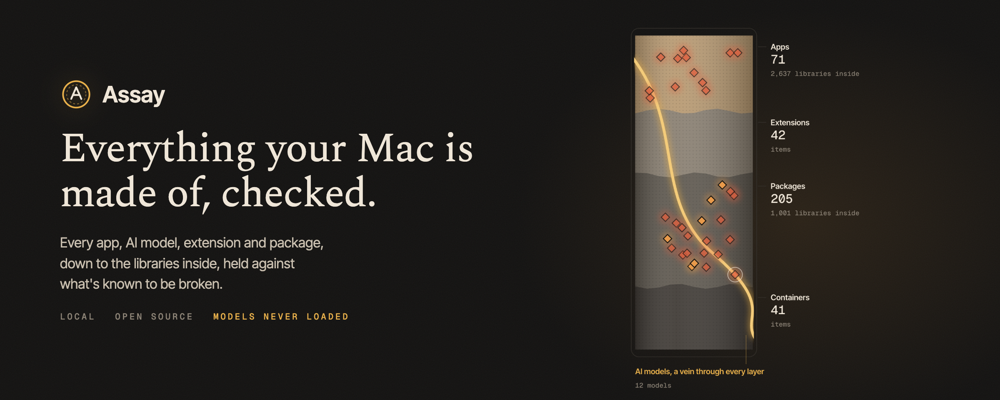
</p>

<p align="center">
  <a href="#the-bench">The bench</a>&nbsp;&nbsp;&nbsp;
  <a href="#ai-models">AI models</a>&nbsp;&nbsp;&nbsp;
  <a href="#the-certificate">Certificates</a>&nbsp;&nbsp;&nbsp;
  <a href="#findings">Findings</a>&nbsp;&nbsp;&nbsp;
  <a href="#acting-on-it">Actions</a>&nbsp;&nbsp;&nbsp;
  <a href="#where-the-data-comes-from">The data</a>&nbsp;&nbsp;&nbsp;
  <a href="#privacy">Privacy</a>&nbsp;&nbsp;&nbsp;
  <a href="#build-it-yourself">Build it</a>
</p>

<br />

Your Mac runs hundreds of pieces of software, and each one is built from dozens or thousands of smaller ones. An app is mostly other people's libraries. A downloaded AI model is a file that some formats let run code the moment it's opened. Nobody tells you when one of those parts turns out to be broken.

Assay reads all of it: every app, AI model, browser and editor extension, Homebrew, npm and pip package, and Docker image, down to the exact version of every library inside. Then it checks each part against what's publicly known to be broken, and reads every model file byte by byte, without loading it, to see whether it would run code. When something needs doing, it tells you what, and every action it takes can be undone.

<p align="center">
  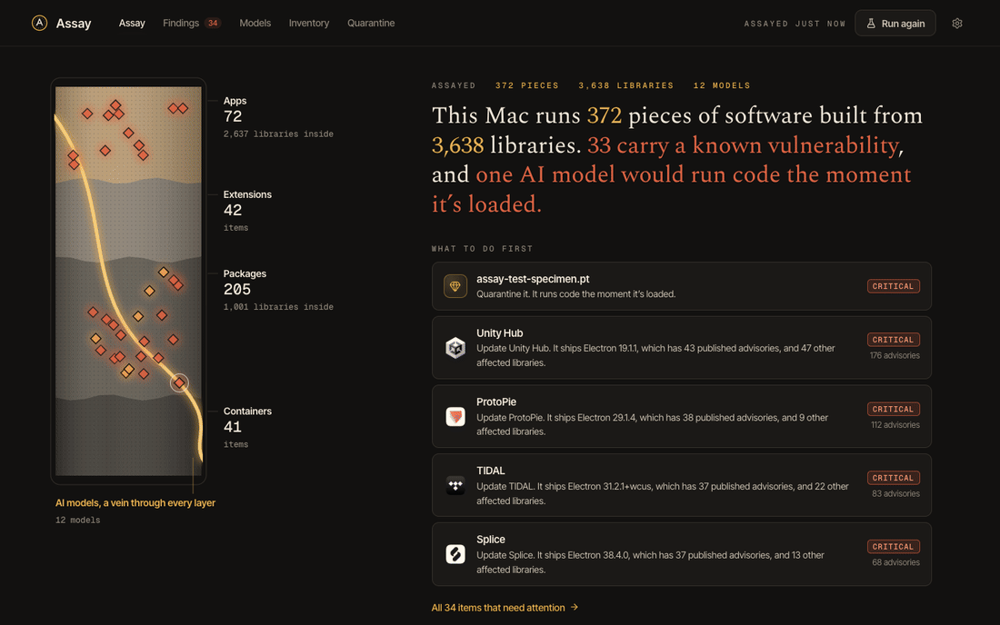
</p>

On the Mac in these screenshots, Assay read **800 pieces of software built from 7,545 libraries** in about fifteen seconds, across four Node installs and four Pythons. **114 of them carry a known vulnerability**: 11 apps because they ship an old copy of Electron, and 63 packages in one forgotten Anaconda environment. Of the 12 AI models on disk (52 GB of them), one would run code when loaded. That one is Assay's own harmless test specimen, which you can write yourself from Settings.

<br />

## The bench

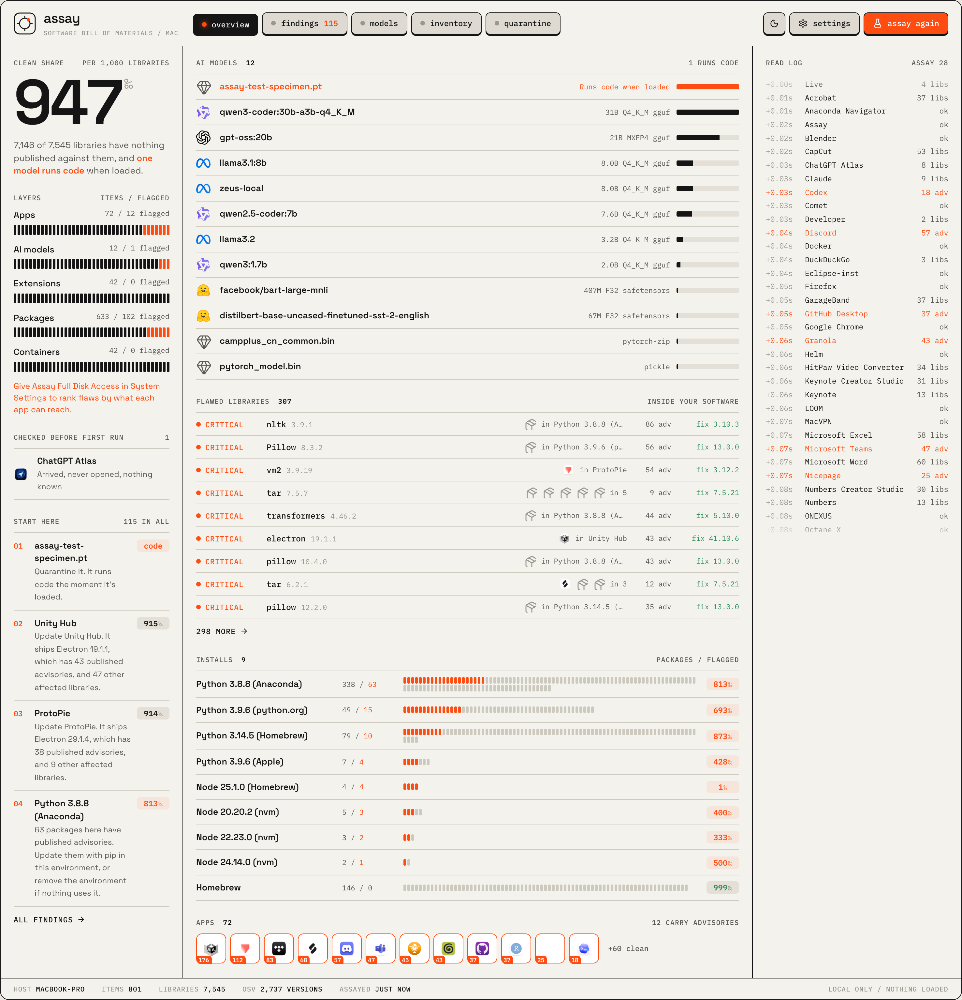

Assay looks and works like a bench instrument. The big readout is the Mac's clean share: of every 1,000 libraries inside its software, how many have nothing published against them. Here it's 947. Beside it, a meter for each layer shows how much of it is flagged, and a short list says what to fix first.

The middle of the bench is the supply chain. Every AI model comes first, with its maker's logo, its size and its precision. Then every flawed library on the machine, once each, with how many things carry it: `tar 7.5.7`, inside five apps. Then every place packages are installed, from Homebrew to each Node and Python, with a strip of its packages and the flagged ones lit. Apps come last, and only the ones carrying advisories. The read log on the right lists everything in the order Assay read it, with the real time it took to get there. While an assay runs, all three columns fill in live.

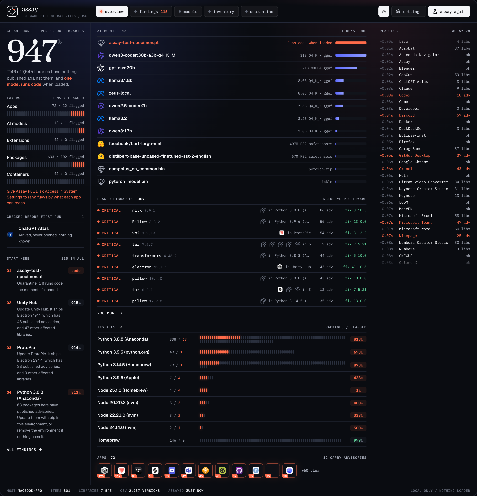

The moon key switches the bench to dark: the same instrument after hours, in blue-black glass with serif numerals. Assay remembers which you prefer.

## AI models

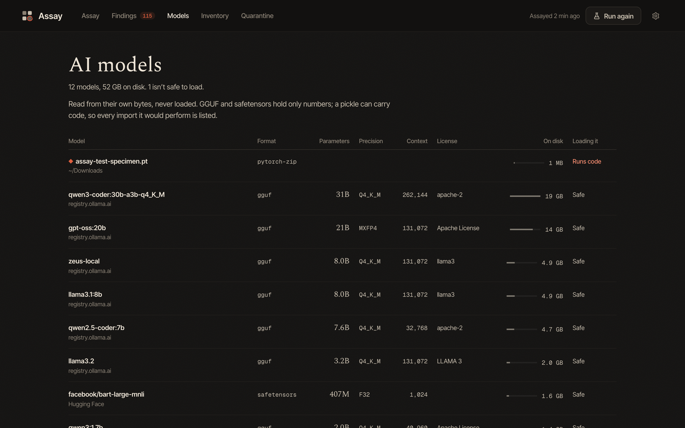

Assay finds models in Ollama, the Hugging Face cache, LM Studio and any folder you point it at, and reads each one from its own header: architecture, parameter count, precision, context length, license and chat template. GGUF and safetensors files hold only numbers and metadata, so they can't carry code.

Pickle files can. A PyTorch `.pt`, `.pth`, `.bin` or `.ckpt` is a little program that Python runs to rebuild the weights, and a malicious one can tell it to run anything else on the way. Assay never loads them. It walks the pickle's instructions one by one, the way Python would, and lists every function the file would import, so `torch._utils._rebuild_tensor_v2` reads as normal and `os.system` reads as what it is.

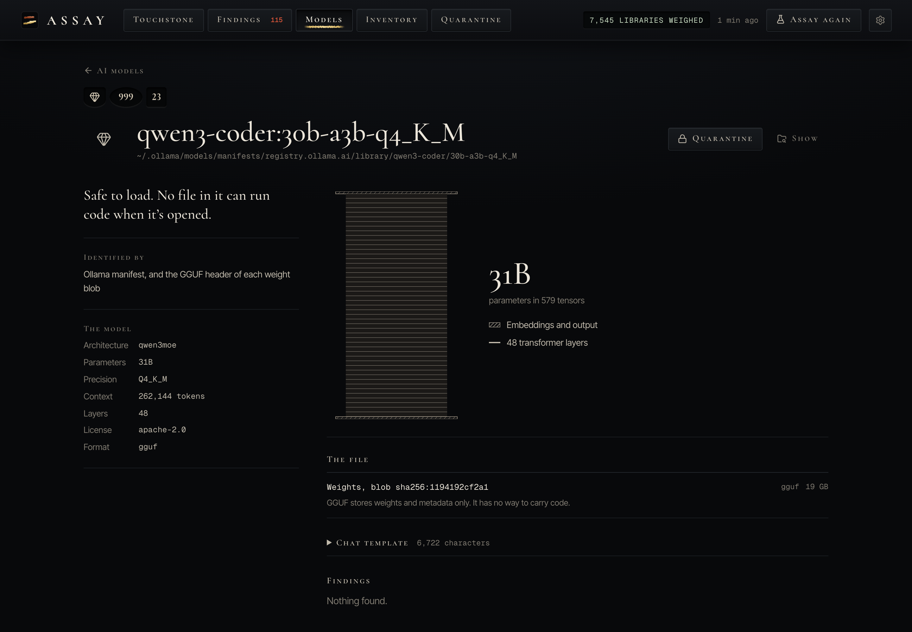

Every model gets a cross-section drawn from its own tensor table: the embeddings, one slice per transformer layer, and the output head, each sized by its share of the parameters. Hover a slice to read it.

## The certificate

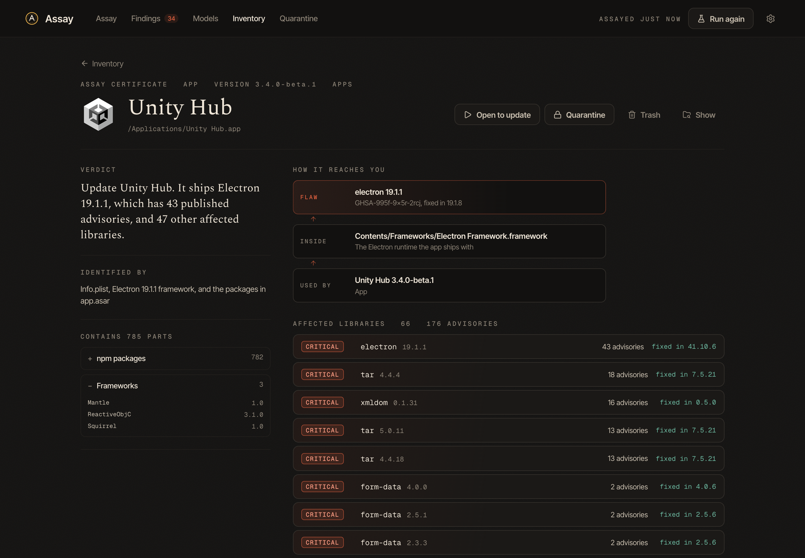

Everything Assay finds has a certificate page: what it is, how it was identified, every part inside it, and a verdict in one line. When something is wrong, it shows how the flaw reaches you, from the broken library, through where it sits inside the app, to the thing you actually use.

Then one row per affected library, worst first, with the number of advisories and the version that fixes them. Open a row for each advisory, linked to its source. An app shipping Electron 19 doesn't get 253 lines of CVEs. It gets one sentence telling you to update it, and the evidence underneath.

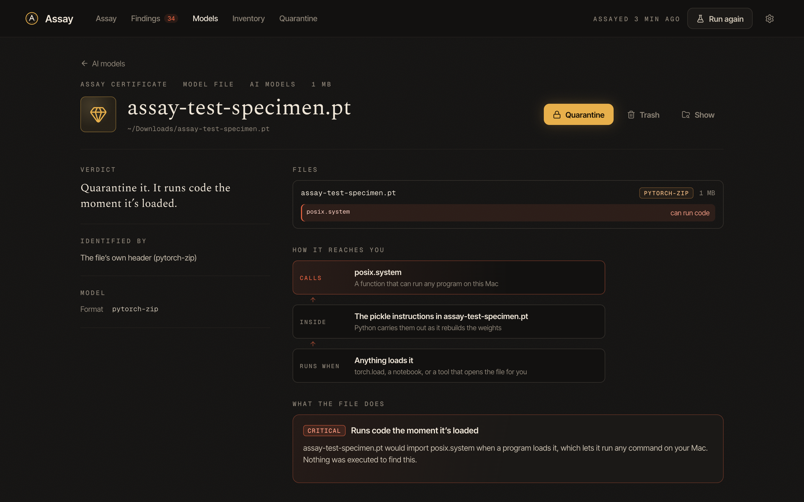

## Findings

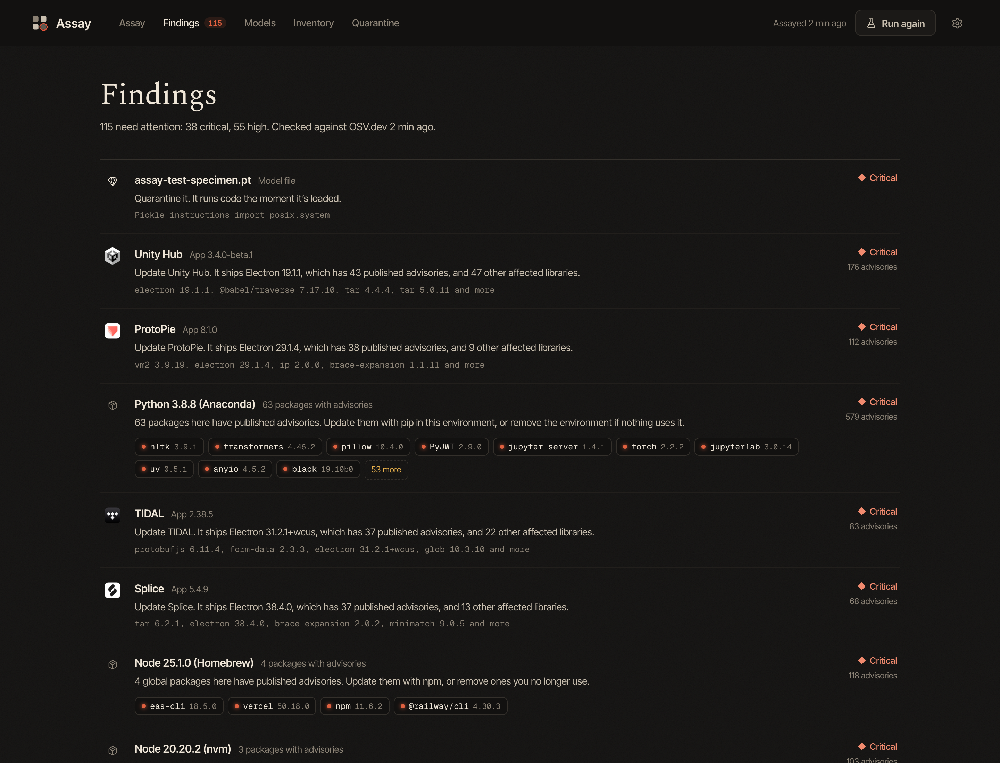

Findings are grouped by what you'd act on, not by advisory. Models that run code come first, then everything else by severity and by what it can reach. Each one says what to do: update the app, update a package to a named version, or quarantine the file. Sixty outdated packages in one old Python install are one decision, so they're one card, with every package a link to its own certificate.

## Flaws times reach

A flaw in an app that can't touch anything matters less than the same flaw in one you've let record your screen. Assay reads the permissions you've actually granted, from macOS's own records, and ranks flawed apps that can see your keystrokes, record the screen, control the Mac or read every file ahead of those that can't. On this Mac, Discord carries 57 advisories and can see keystrokes and record the screen, so it sits right behind the one model that runs code. Each app's page lists what it can reach. Reading the records needs Full Disk Access; without it Assay ranks by flaws alone and says so.

## Check before first run

Assay keeps watching after an assay ends. When a new app lands in Applications, or a new model in Ollama, the Hugging Face cache or one of your model folders, Assay reads it right away, before anything opens or loads it, and tells you what it found. Downloaded apps that have never been opened are marked as such, so everything on their page was read without running them. A malicious pickle gets caught on the way in, not after it's loaded.

## Every install, not just the first on your PATH

Macs collect installs: Node from Homebrew and three versions from nvm, Python from Homebrew, python.org, Anaconda and Apple's developer tools. A terminal only sees the first one on its PATH, and a Mac app sees a different PATH again. Assay finds each one, runs its own `npm` or `pip` in a clean environment so one install's settings can't leak into another's, and labels every package with the install it lives in. When pip itself crashes on a malformed package, as Anaconda's does here, Assay reads Python's own package metadata instead.

A library being present means the app ships it, not that the app uses the affected feature, and Assay says so on every page where it matters.

## Acting on it

Every action is reversible, and nothing happens until you press a button and confirm it.

- **Quarantine** moves a model, app or extension into Assay's own folder, where nothing will find or load it. Release puts it back exactly where it was. For an Ollama model only the manifest moves, since weight blobs are shared between tags.
- **Update** runs the package manager that installed it: `brew upgrade`, `npm install -g`, or `pip install --upgrade` in that package's own environment.
- **Trash** moves it to the Trash, so it can go straight back.
- **Show** reveals it in Finder, and **Open** launches an app so it can update itself.

The saved assay follows what you do. A quarantined item leaves every page and comes back with its findings when you release it.

## Assay and Teardown

[Teardown](https://github.com/AllStreets/teardown) takes a single app apart: how it's built, what it's been allowed, and what changed when it updated. Assay checks what everything is made of. They know about each other: every app's page in Assay opens it in Teardown, at its X-ray, its permissions, or its version history, where an update can be rolled back.

## In the menu bar, and for AI agents

Close the window and Assay keeps watching from the menu bar. When it catches something on the way in, you get a macOS notification; click it and Assay opens on exactly that item.

Assay also ships an MCP server, so an assistant like Claude can use it as a tool: "is anything on this Mac known to be exploitable?", "what still ships an old Electron?", "which of my models would run code?". It can quarantine or release something too, but only when you've agreed.

```sh
npm run build:mcp
claude mcp add assay -- node "$(pwd)/build/assay-mcp.mjs"
```

Tools: `summary`, `list_findings`, `get_item`, `which_carry`, `list_models`, `run_assay`, `quarantine`, `release`. The server reads everything from the running Assay engine, so open the app first.

## How it knows

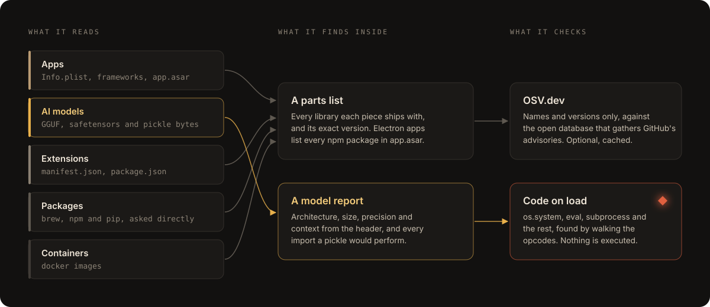

## Where the data comes from

There is no AI inside Assay. No model runs, and none is ever loaded. Every fact comes from reading files on your disk, asking your package managers, and, if you allow it, looking versions up in a public database. The sentences are templates filled in with what was measured. You can check any of it yourself:

| Assay says | Where it comes from | Check it yourself |
| --- | --- | --- |
| Ships Electron 19.1.1 | `Electron Framework.framework` in the app, version from its `Info.plist` | `plutil -p ".../Electron Framework.framework/Resources/Info.plist"` |
| Bundles form-data 2.5.1 | the `package.json` of each module inside `app.asar` | `npx @electron/asar list /Applications/<App>.app/Contents/Resources/app.asar` |
| 43 published advisories | [OSV.dev](https://osv.dev), queried by package name and version | `curl -d '{"package":{"ecosystem":"npm","name":"electron"},"version":"19.1.1"}' https://api.osv.dev/v1/query` |
| 31B parameters, Q4_K_M, 262,144 context | the GGUF header and tensor table | `pip install gguf`, then `gguf-dump ~/.ollama/models/blobs/sha256-...` |
| Would import `posix.system` when loaded | the pickle's opcodes, walked without running them | `python3 -m pickletools data.pkl` |
| Installed with Homebrew, npm, pip | the tools themselves, once per install | `brew info --json=v2 --installed`, `npm ls -g --json`, `python3 -m pip list --format=json` |

## Privacy

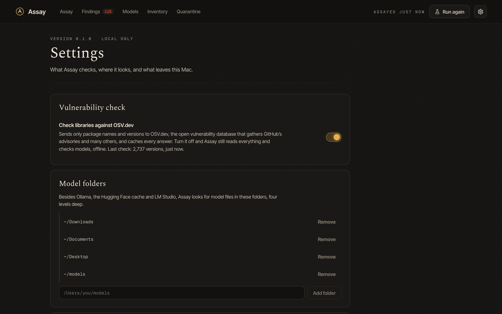

Assay runs on your Mac. It has no account, no analytics and no server of its own. The only thing that ever leaves the Mac is the optional vulnerability check, which sends package names and versions, and nothing else, to OSV.dev, the open vulnerability database that gathers GitHub's advisories, the Python advisory database and many others. Every answer is cached, and the check can be switched off; Assay still reads everything and checks every model offline.

Everything Assay keeps lives in `~/Library/Application Support/Assay`. You can hide any item, and it's left out of every assay from then on.

The first time the Mac app reads your Downloads, Documents or Desktop folder for model files, macOS asks for permission. Say yes, or remove those folders in Settings.

## Try it on something bad

Settings can write `assay-test-specimen.pt` to your Downloads folder: a real PyTorch file whose pickle imports `os.system`, the same pattern real malicious models use. Its command only prints a line, so it's harmless even if something does load it, the way antivirus tools use the EICAR test file. Run the assay again and it's the first thing on the list of what to fix. Quarantine it, then release it, to see the undo work.

## Build it yourself

There's no signed download, on purpose. Assay is meant to be built from source you can read, so you never have to trust a binary from anyone, including me.

You'll need macOS 12 or later on Apple silicon, Node 22, Rust, and the Xcode command line tools.

```sh
git clone https://github.com/AllStreets/Assay.git
cd Assay
npm install
npm run app
```

That builds `Assay.app` into `src-tauri/target/release/bundle/macos/`. Drag it to Applications. The build signs with a local certificate named in `src-tauri/tauri.conf.json`; change `signingIdentity` to `-` if you don't have one.

### Or run it in a browser

The same interface works in any browser, no Rust needed:

```sh
npm install
npm run dev
```

Then open http://localhost:4721. The first assay takes about half a minute. After that, anything that hasn't changed comes from the cache and it takes a few seconds.

## How it's put together

| Part | What it does |
| --- | --- |
| `server/collectors/apps.ts` | Reads each app's `Info.plist`, its frameworks, and every npm package in `app.asar` |
| `server/collectors/models.ts` | Finds models in Ollama, the Hugging Face cache, LM Studio and your folders |
| `server/collectors/extensions.ts` | Chrome, Brave, Edge, Arc and other Chromium browsers; VS Code, Cursor and Windsurf |
| `server/collectors/packages.ts` | Homebrew, every Node install's global npm, every Python's pip, and Docker images |
| `server/models/gguf.ts` | A GGUF reader: header, metadata and tensor table |
| `server/models/pickle.ts` | A static pickle walker for protocols 0 to 5, PyTorch zip archives and safetensors headers |
| `server/vuln/osv.ts` | Batched OSV.dev lookups with an on-disk cache |
| `server/findings.ts` | Turns what was read into findings and severities |
| `server/grants.ts` | Reads the permissions you've granted from macOS's TCC records |
| `server/watch.ts` | Watches for new apps and models and checks them before first run |
| `server/actions.ts` | Quarantine, release, update, trash, reveal, and handing over to Teardown |
| `server/mcp.ts` | The MCP server for AI agents |
| `web/` | The React interface, in light and dark; the meters, library strips and model cross-sections are drawn by hand |
| `src-tauri/` | The Mac app: a small Rust shell that runs the engine beside it, shows the interface in the system WebKit, lives in the menu bar and sends notifications |

```sh
npm test        # the pickle walker against payloads for every protocol
npm run typecheck
```

## License

MIT.
